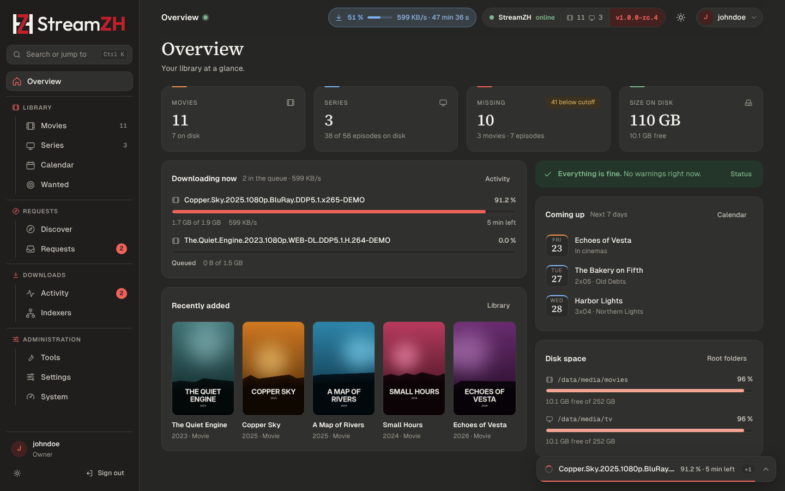
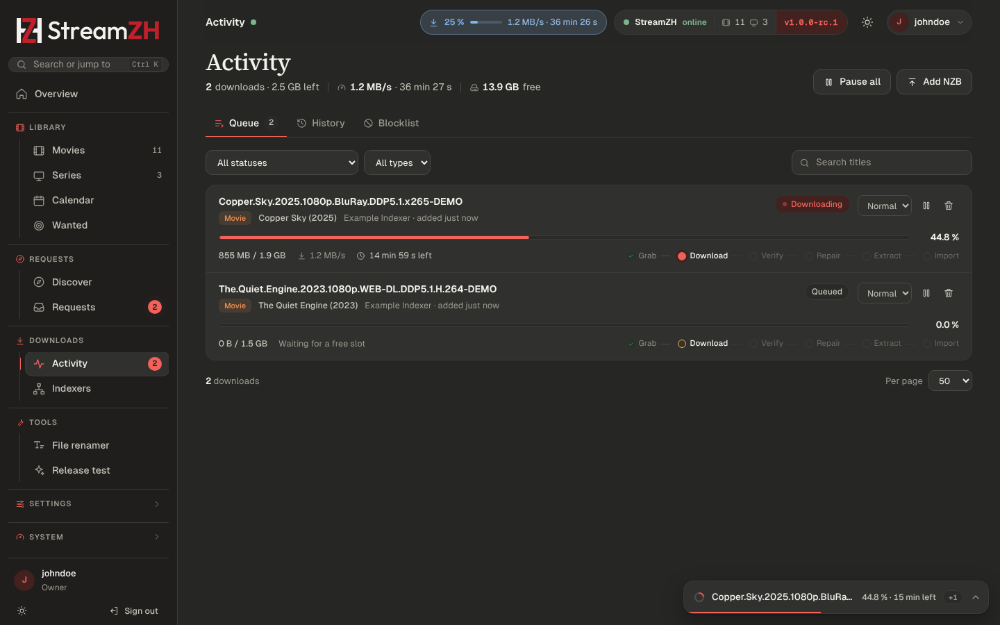
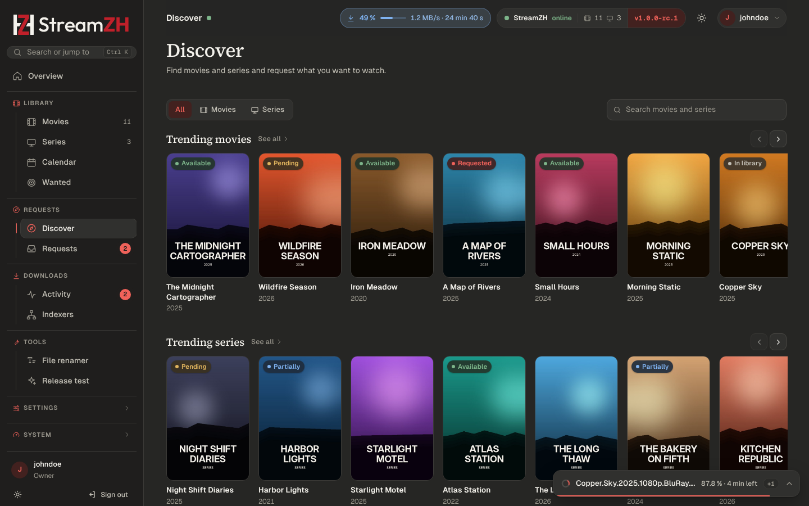
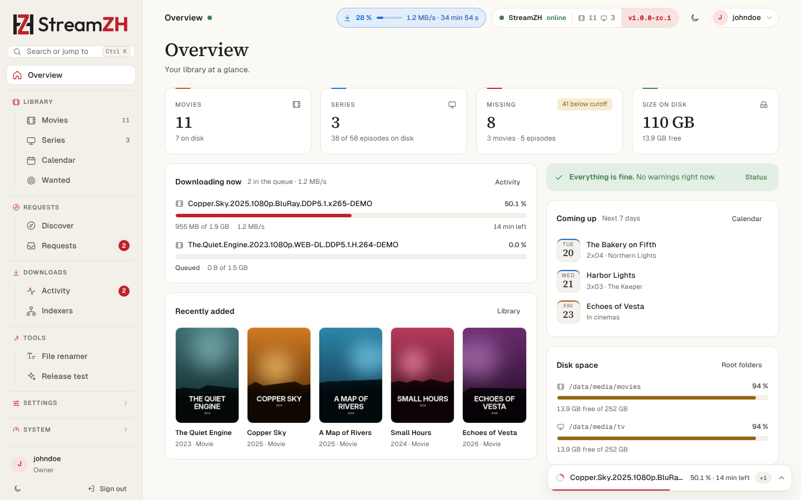

<p align="center">
  <picture>
    <source media="(prefers-color-scheme: dark)" srcset="docs/brand/streamzh-logo-dark.svg">
    
  </picture>
</p>

<p align="center">One app for your whole media pipeline.</p>

> **Status:** 1.0 release candidate. Feedback welcome in the [issues](https://github.com/streamzh/streamzh/issues).

StreamZH finds, downloads, repairs, unpacks, renames and files your movies and series, and lets friends request
what they want to watch. It does in **one application** what usually takes six:

| Usually | In StreamZH |
|---|---|
| Radarr and Sonarr | **Library**: movies and series, monitoring, upgrades, renaming, calendar |
| Prowlarr | **Indexers**: Newznab and Torznab indexers, limits, stats, search across all of them |
| SABnzbd | **Built-in Usenet engine**: download, par2 repair, unpack |
| A torrent client | **Built-in torrent engine**, or qBittorrent, Transmission and Deluge |
| Recyclarr | **TRaSH Guides sync**: profiles and custom formats kept up to date |
| Requestrr (and request apps) | **Discover and requests** for friends, with a built-in **Discord bot** |

One login, one database, one queue, one API. StreamZH runs on Windows, Linux, macOS and in Docker, is free and open
source (GPL-3.0), and sends no analytics anywhere.

StreamZH ships no list of indexers and no content. Add only sources you are permitted to use.

<!-- Screenshots of a demo instance with example data; how they are made: docs/images/README.md. -->
<table>
  <tr>
    <td></td>
    <td></td>
  </tr>
  <tr>
    <td></td>
    <td></td>
  </tr>
  <tr>
    <td></td>
    <td></td>
  </tr>
</table>

## Features

- **Library**: movies and series from TMDB, monitoring per movie, series and season, standard, daily and anime
  numbering (with TheXEM scene numbering), alternative titles, import of the folders you already have, mass editor,
  Organize (rename and move to your naming scheme, with undo), media info from ffprobe.
- **Search and grab**: RSS sync, automatic and interactive search, Wanted (missing and cutoff unmet), blocklist and
  retry after failed downloads, Usenet/torrent preference with delays, a release test that explains every decision.
- **Quality**: quality profiles with groups and cutoff, custom formats with scores (Radarr/Sonarr compatible JSON),
  release profiles, size limits per quality, TRaSH Guides templates and daily sync, `recyclarr.yml` import.
- **Indexers**: a catalog of known Newznab and Torznab indexers, query and grab limits, VIP expiry, health back-off,
  search across all indexers, stats and history, one-click import from Prowlarr.
- **Downloads**: a Usenet engine with backup servers, categories, scheduler, par2 repair and 7-Zip unpacking; a
  torrent engine with seed goals; qBittorrent, Transmission and Deluge; remote path mappings.
- **Requests**: Discover (trending, popular, upcoming, top rated), requests with approval or auto-approve, limits,
  invite links, roles (Owner, Admin, Friend, Requester), a Discord bot with `/movie`, `/tv` and `/requests`.
- **Connect**: Plex, Jellyfin, Emby and Kodi library updates; Discord, Telegram, Pushover, ntfy, Gotify, email,
  Apprise and webhooks. Calendar with an iCal feed. Import lists from TMDB, Trakt, Plex watchlists and RSS.
- **Moving over**: a migration wizard takes over Radarr, Sonarr, Prowlarr and SABnzbd (settings, indexers, servers and
  the library with its files) without changing them, and a side-by-side mode lets both run until you switch over.
- **Runs unattended**: Windows service with tray icon, systemd service, Docker image with health check, scheduled
  backups, and a status window that says what is happening right now.

## Quick start

Downloads are on the [releases page](https://github.com/streamzh/streamzh/releases). After installing, open
**http://localhost:9797** (or `http://<server>:9797` from another device) and create the owner account.
[docs/INSTALL.md](docs/INSTALL.md) covers every platform in detail.

### Windows

Run `StreamZH-<version>-win-x64-setup.exe`. It installs StreamZH to `C:\Program Files\StreamZH`, keeps your data in
`C:\ProgramData\StreamZH`, and runs it as a Windows service with a tray icon (or with the tray icon only, if you
prefer). A portable `StreamZH-<version>-win-x64.zip` is available as well. Details: [INSTALL.md → Windows](docs/INSTALL.md#windows).

### Linux

```bash
# Debian, Ubuntu
sudo apt install ./streamzh_<version>_amd64.deb
# Fedora, RHEL, openSUSE
sudo dnf install ./streamzh-<version>.x86_64.rpm
# Any distribution with systemd
tar -xzf StreamZH-<version>-linux-x64.tar.gz && sudo bash StreamZH-<version>-linux-x64/install-linux.sh
```

For 64-bit ARM use the `arm64` / `aarch64` files.

StreamZH runs as the systemd service `streamzh` under its own user `streamzh`. Give that user access to your media
folders, e.g. `sudo setfacl -R -m u:streamzh:rwX -m d:u:streamzh:rwX /data/media`. Details:
[INSTALL.md → Linux](docs/INSTALL.md#linux).

### Docker

```bash
docker run -d --name streamzh --restart unless-stopped \
  -p 9797:9797 -p 51414:51414 -p 51414:51414/udp \
  -e PUID=1000 -e PGID=1000 -e TZ=Etc/UTC \
  -v /opt/streamzh/config:/config -v /data:/data \
  ghcr.io/streamzh/streamzh:latest
```

Release candidates are tagged by version only (e.g. `ghcr.io/streamzh/streamzh:1.0.0-rc.1`). `docker logs streamzh`
shows the one-time setup code the first page asks for. A compose file, `UMASK` and reverse proxies:
[INSTALL.md → Docker](docs/INSTALL.md#docker).

### macOS

Unpack `StreamZH-<version>-osx-arm64.zip` (Apple silicon) or `StreamZH-<version>-osx-x64.zip` (Intel), remove
the download quarantine once (`xattr -dr com.apple.quarantine StreamZH`; the app is not notarized) and start
`StreamZH/StreamZH`. Details:
[INSTALL.md → macOS](docs/INSTALL.md#macos).

## First steps

1. **Create the owner account.** From another device than the server, the setup page asks for the setup code that
   StreamZH prints in its console and log.
2. **Get started** opens next and ticks off what StreamZH still needs, most of it right on the page:
   - **Storage locations** and **root folders**: where your movies and series live. StreamZH only touches folders
     inside the storage locations the owner allows; the root-folder dialog adds yours in one click.
   - **TMDB key**: free, from themoviedb.org. Titles, posters and episode lists come from there.
   - **Release language**: any, the original language, or German; it picks the default quality profile.
   - **Indexers** (or Import from Prowlarr) and **a download client**: your Usenet server for the built-in engine,
     the built-in torrent engine, or your torrent client.
3. **Add a movie or series**, or import the folders you already have.

The [getting started guide](docs/guide/getting-started.md) walks through each step.

## Coming from Sonarr, Radarr, Prowlarr and SABnzbd?

Settings → Migration takes everything over through the old apps' APIs: settings, profiles, custom formats, indexers,
Usenet servers, download clients, and your movies and series with the files you already have (linked where they
are, never moved or downloaded again). The old apps are only read, never changed, and the side-by-side mode keeps
StreamZH from grabbing anything until you switch over. See [docs/MIGRATION.md](docs/MIGRATION.md).

## Documentation

- [Installation](docs/INSTALL.md): Windows, Linux, Docker, macOS, reverse proxies, updates, backups
- [User guide](docs/guide/README.md): getting started, library, searching, indexers, downloads, quality, requests,
  users, notifications, calendar, every setting, system pages, API, troubleshooting, glossary
- [Migration](docs/MIGRATION.md) from Radarr, Sonarr, Prowlarr and SABnzbd
- [Security](docs/SECURITY.md): what StreamZH protects, safe deployment, the data folder
- [Webhook payload](docs/WEBHOOK.md), [Architecture](docs/ARCHITECTURE.md), [Roadmap](docs/ROADMAP.md),
  [Decisions](docs/DECISIONS.md), [Changelog](CHANGELOG.md)

## Security in short

Keep sign-in on, and reach StreamZH from the internet only through a reverse proxy with HTTPS, never by forwarding
port 9797. A fresh installation can only be claimed from the server itself or with the setup code. Stored passwords
and API keys are encrypted, Admins and the API key cannot change owner-only settings such as backups and tool paths,
and StreamZH only writes inside the storage locations the owner allows. Treat backups and the data folder like
passwords. Details in [docs/SECURITY.md](docs/SECURITY.md); report vulnerabilities privately as described in
[SECURITY.md](SECURITY.md).

## Contributing

Bug reports, ideas and pull requests are welcome. [CONTRIBUTING.md](CONTRIBUTING.md) explains how to build StreamZH
from source, run the tests and send changes. Please follow the [code of conduct](CODE_OF_CONDUCT.md).

## License

StreamZH is a CloudZH product, licensed under the [GNU General Public License v3.0](LICENSE) (GPL-3.0-only). Code
ported from Radarr, Sonarr, Prowlarr and other projects keeps its origin and is listed in [NOTICE.md](NOTICE.md).
StreamZH is not affiliated with these projects, with TMDB or with the TRaSH Guides.
