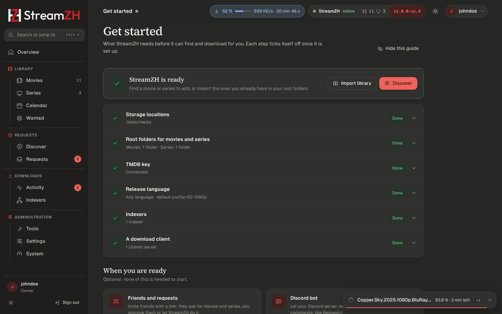

# Getting started

After [installing](../INSTALL.md), open **http://localhost:9797** on the server (or `http://<server>:9797` from
another device). These steps take about ten minutes.

Coming from Radarr, Sonarr, Prowlarr or SABnzbd? Do step 1, then let the [migration wizard](../MIGRATION.md) take
over root folders, quality profiles, indexers and download clients for you (**Start migration** on the Get started page,
or Settings → Migration with the *Advanced* switch on).

Right after you create the owner account, StreamZH opens the **Get started** page (`/get-started`) with steps 2 to 7
below: storage locations, root folders, TMDB key, release language, indexers and a download client. Most of them can
be done right on the page. Each step ticks itself off once StreamZH sees it is set up, also when the migration wizard
did it; when all six are done the page says "StreamZH is ready". The Overview shows a "Setup: n of 6 done" card with
the next step until then; its **×** (or **Hide this guide** on the page) hides it, and Get started stays reachable
through the search (Ctrl K). Only owners and admins see it.

## 1. Create the owner account

The first account is the **owner**: full access, and it manages everyone else. Choose a user name and a password of
at least 8 characters.

From another device than the server (and always with Docker) the page asks for the **setup code**. StreamZH shows it
in its console and log (`docker logs streamzh`, `journalctl -u streamzh`), writes it to the file `setup-code` in the
data folder, and shows it under **Show setup code** in the Windows tray icon. On the server itself, opened as
`localhost` or by its IP address, no code is needed.

## 2. Storage locations

**Storage locations** are the folders StreamZH may use for media and downloads (Settings → General → Storage, owner
only). Every folder you set later (root folders, download folders, the recycle bin, …) must be inside one of them,
so StreamZH can never be pointed at a system folder.

A new installation allows only its own download folder (`<data>/downloads`). You add your media folder in the next
step with one click. Add a location here yourself when you want a whole drive or share allowed at once, for example
`/data` (Docker), `D:\Media` or `\\nas\media`.

## 3. Root folders

Settings → Media Management → **Root folders**: the folders your movies and series live in, for example
`/data/media/movies` and `/data/media/tv`. Click **Add folder**, browse or type the path. When the folder is outside
the storage locations, the owner gets **Allow and add**.

StreamZH must be able to write there. If the folder shows **Read only**, give StreamZH's account access (see
[INSTALL.md → Folders and permissions](../INSTALL.md#folders-and-permissions)).

## 4. TMDB API key

Settings → Metadata → **API token**. Titles, posters, episode lists and Discover come from
[The Movie Database](https://www.themoviedb.org/). Create a free account, open
[Settings → API](https://www.themoviedb.org/settings/api) and paste the *API Read Access Token* (or the shorter API
key). While you are there, choose the **Language** for titles and descriptions.

## 5. Release language

Which audio language StreamZH looks for. The choice sets the **default quality profile** for new movies and series:

| Choice | Default profile |
|---|---|
| **Any language** (the default of a new installation) | *HD-1080p*: the best 1080p release in whatever language it comes |
| **Original language** | *HD-1080p*, set to the movie's or series' own language |
| **German** | *Deutsch 1080p*: German audio, releases with German and the original language (dual language) preferred |

You can change it at any time on the page, pick another profile per movie or series, or create your own profile;
see [Quality](quality.md).

## 6. Indexers

**Indexers** (sidebar, Downloads group) → **Add indexer**. Pick yours from the catalog of known Usenet (Newznab) and
torrent (Torznab) indexers, or *Generic Newznab* / *Generic Torznab*, enter the API key and press **Test**. Using
Prowlarr? **Import from Prowlarr** brings all of them over at once. See [Indexers](indexers.md).

## 7. A download client

Where grabbed releases are downloaded:

- **Usenet**: Settings → **Usenet servers** → Add server. Enter the news server of your provider (host, SSL port 563,
  user name, password, connections). StreamZH's built-in engine downloads, repairs and unpacks by itself.
- **Torrents**: Settings → **Download clients**. Turn on the **built-in torrent engine**, or add qBittorrent,
  Transmission or Deluge.

See [Downloads](downloads.md).

## 8. Add something

- **Movies** or **Series** → **Add movie / Add series**: search TMDB, choose root folder and quality profile, keep
  *Monitored* on and tick *Start search for missing* to look for it right away.
- Already have a library? **Import existing** on the Movies or Series page matches your folders with TMDB and adds
  them. Nothing is moved or renamed. See [Library](library.md#import-existing-folders).

Follow what happens in **Activity** (the queue) and in the **status window** (bottom right), which shows running
work and warnings.

## Optional next steps

- **Quality**: a new installation has five profiles (*Any*, *HD-1080p*, *Ultra-HD*, *Deutsch 1080p*,
  *Deutsch 2160p*); new items get the default profile, *HD-1080p* in any language unless you chose another release
  language in step 5. **Set as default** on Settings → Profiles changes it; the TRaSH Guides sync creates profiles
  and custom formats for you. See [Quality](quality.md).
- **Connect** your media server (Plex, Jellyfin, Emby, Kodi) so it scans new files at once, and set up
  notifications. See [Connect](connect.md).
- **Friends and requests**: invite users, let them request on Discover or through the Discord bot. See
  [Requests](requests.md) and [Users and roles](users.md).
- **Backups** run every 7 days by default. Move them to another drive in Settings → General → Backups.
