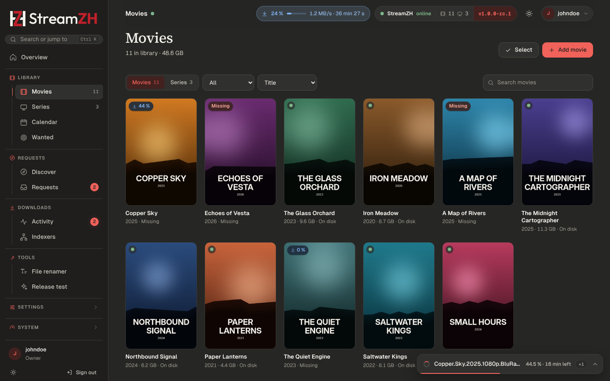
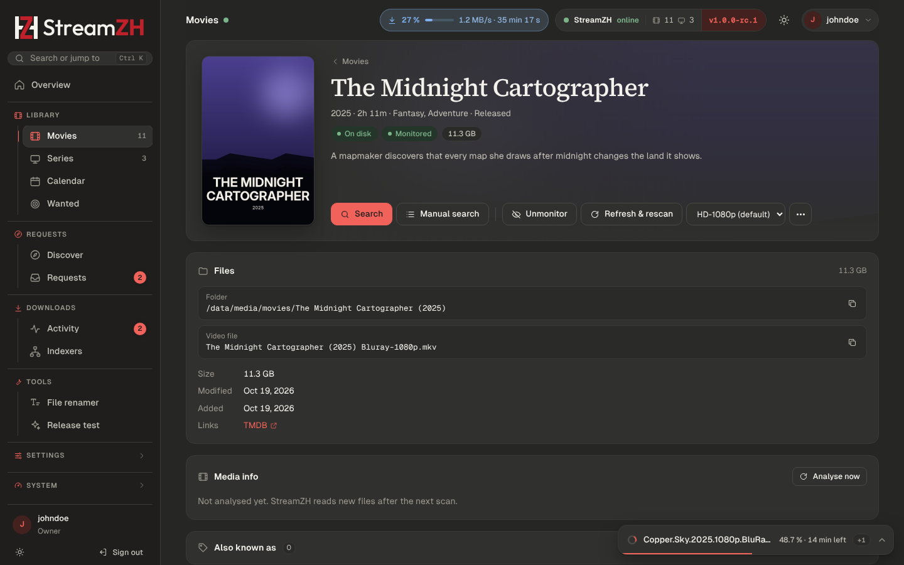

# Library

**Movies** and **Series** (sidebar, Library group) list everything StreamZH manages, as a poster grid with filters
(All, On disk, Missing, Unmonitored), sorting (title, year, recently added) and a search box. A badge on each poster
shows its state: on disk, missing, incomplete (series with missing episodes), downloading, unmonitored.

Before you can add anything, StreamZH needs a [TMDB API key and a root folder](getting-started.md); the library
pages say so when one is missing.

## Add a movie or series

**Add movie / Add series** searches TMDB. Pick the title, then:

| Option | Meaning |
|---|---|
| Root folder | Where its folder is created (Settings → Media Management → Root folders) |
| Quality profile | Which releases are wanted and until when to upgrade ([Quality](quality.md)) |
| Series type | Standard, Daily or Anime (see below). Shown when the series looks like daily or anime, or in Advanced mode |
| Monitored | StreamZH looks for it and grabs it. For series: all regular seasons |
| Start search for missing | Search right away instead of waiting for RSS sync (Settings → Indexers → *Search when adding* sets the default) |

Movies are grabbed automatically from their **minimum availability** on (Settings → Indexers: announced, in
cinemas, or released). The Search button always searches.

## The detail page

A movie or series page shows the poster, overview, folder, files and history, and these actions:

- **Search** queues an automatic search: the best release is grabbed in the background. **Manual search** shows all
  releases with the reasons StreamZH would reject some ([Searching](searching.md#interactive-search)). Series also
  have *Search season* (and Manual search for it) and a manual search per episode.
- **Refresh & rescan** loads the metadata from TMDB again and reads the folder.
- **Monitored** switches for the movie, the series and each season.
- **Quality profile** and, for series, **Series type** can be changed.
- **More** (the menu): *Rename files*, *Organize*, *Remove*.
- **History**: what was grabbed, imported, upgraded, renamed or deleted for this item.
- **Media info** (with ffprobe): codec, resolution, HDR, audio channels and languages, subtitles of the file. *Read
  the file with ffprobe again* refreshes it.
- **Also known as**: alternative titles (below).

## Series types

| Type | Episodes are named and searched by | For |
|---|---|---|
| Standard | Season and episode (`S01E05`) | Most series |
| Daily | Air date (`2026.10.18`) | Talk shows and news |
| Anime | Absolute episode number (`Title - 26`) and scene numbering | Anime releases |

For anime, StreamZH reads the scene numbering from **TheXEM**: when release groups number a series differently from
TMDB, the episode list shows the scene number next to the TMDB one, and searches and imports use it. The
*Anime episode format* (Settings → Media Management, Advanced) can use `{absolute:000}`.

## Alternative titles

Releases often carry another title than TMDB's main one: a translation, a scene name, a former title. The
**Also known as** panel on the detail page lists the titles StreamZH matches releases against: TMDB's alternative
titles and translations, scene names from TheXEM, and your own titles (*Add your own title*, for example the German
one). With *Search alternative titles* (Settings → Indexers, Advanced; on by default) searches also use them when an
indexer cannot search by id or finds nothing.

## Import existing folders

When a root folder already contains movie or series folders, the library page shows **Import n existing**. The
import page matches each folder with TMDB (by folder name and year), lets you correct a match (*Search TMDB by hand*)
or skip a folder, and adds the chosen ones with their files. **Nothing is moved or renamed.**

Coming from Radarr or Sonarr? The [migration wizard](../MIGRATION.md) takes over the library with monitoring,
profiles and history instead.

## Select, mass edit and remove

**Select** (owners and admins) turns the grid into a selection. The bar at the bottom then sets for all selected
items: **Monitor** / **Unmonitor**, **Quality profile…**, **Root folder…** (move them to another root folder or only
change the path), **Organize…** and **Remove…**.

**Remove** takes an item out of StreamZH; its files stay unless you tick *Delete files and folder*. Deleted files go
to the recycle bin when one is set (Settings → Media Management → File management), else they are gone for good.

Moving to another root folder: *Move the folders there* moves them (to another drive: copied first, the old folder
is deleted only after the copy is complete); *Only change the path* moves nothing, for when you move the files
yourself.

## Rename and Organize

Imported files are named with the formats of Settings → Media Management (for example
`{Movie Title} ({Release Year}) {Quality Full}`). For files that do not follow them yet:

- **Rename files** (detail page) renames the files of one movie or series to the current format, after a preview.
- **Organize** (detail page or mass editor) renames **folders and files** to the naming scheme, with a preview of
  every change. Subtitles, NFO files and artwork next to a video get the new name too. The run continues in the
  background (the status window shows it), and **Undo** puts everything back for the next 24 hours.

Do not rename or organize while Radarr or Sonarr still manage the same files (side-by-side phase of a migration).

## File renamer

Tools → **File renamer** renames any files, not only library items: for example a folder of downloads you want to
tidy up before importing. Nothing changes before you press **Rename**, and every run can be undone from its history.

- **Simple**: choose a folder (or a movie or series) and one name pattern; episodes and movies get their real titles
  from the library or TMDB. Presets for Plex/Jellyfin/Emby, with quality, scene style and more.
- **Advanced**: a filter (text, `*S01*` patterns or `/regex/`, subfolders, files and/or folders, leave out samples)
  and a list of **rules** that run from top to bottom: *Media names*, *Replace* (text or regular expressions with
  `$1` groups, with a tester), *Remove*, *Insert*, *Case*, *Counter*, *Extension*, *Trim*. Subtitles and other files
  with the video's name follow it. Rules, filter and options can be saved as **presets**.

The preview marks conflicts; files with a conflict are left as they are.

## Monitoring and what gets downloaded

- A **monitored** movie or episode that has no file is *missing*: RSS sync and searches grab it when a release fits
  its profile.
- A file below the profile's cutoff (or in the wrong language) is *cutoff unmet*: StreamZH keeps upgrading while the
  profile allows upgrades.
- **Wanted** (sidebar) lists both, with *Search all*. See [Searching](searching.md#wanted).
- *Unmonitor deleted files* (Settings → Media Management) stops monitoring an item whose file you deleted, so it is
  not downloaded again.
