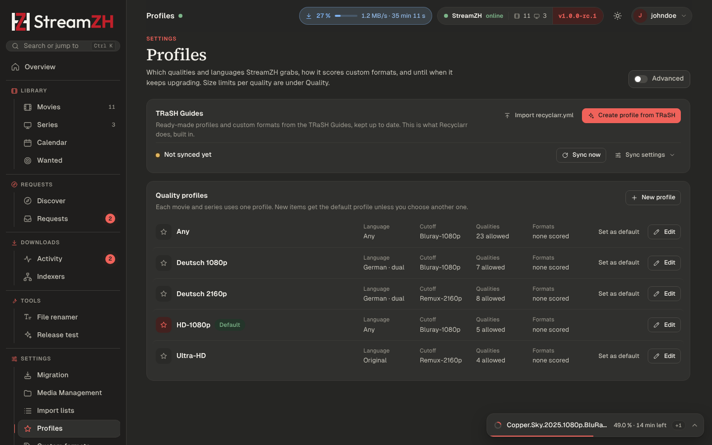

# Quality

Which release StreamZH grabs, and when it replaces a file with a better one, is decided by four things:

| Where | What |
|---|---|
| Settings → **Profiles** | Quality profiles: allowed qualities, cutoff, language, custom format scores. Also the TRaSH Guides |
| Settings → **Custom formats** | Conditions on release names, groups, languages, sources, sizes … that profiles score |
| Settings → **Quality** | Size limits per quality |
| Settings → **Indexers** → Release profiles | Words a release must, must not or should contain |

## Quality profiles

Each movie and series uses one profile; new items get the **default** profile unless you choose another.
A new installation has *Any*, *HD-1080p* (the default, any language), *Ultra-HD*, *Deutsch 1080p* and *Deutsch 2160p*.
The **release language** step of [Get started](getting-started.md#5-release-language) switches the default to
*HD-1080p* in the original language or to *Deutsch 1080p* (German, dual language preferred). Installations from
before 1.0 keep their profiles and their default.
**Set as default** changes the default; **New profile** creates one.

| Part | Meaning |
|---|---|
| Name | |
| Language | The language releases must have: a language, *Original language* (the movie's or series' own) or *Any language* |
| Prefer dual language | Prefer releases with two audio languages (e.g. `German.DL`) |
| Qualities, best first | Tick the allowed qualities and move them up or down. Select two or more and **group** them: grouped qualities rank equally and the custom format score decides (e.g. "WEB 1080p" for WEBDL and WEBRip) |
| Upgrades allowed | Replace a file with a better release |
| Upgrade until (cutoff) | Once a file has this quality, StreamZH stops looking for better releases |
| Custom formats | A score per custom format (separate lists for movies and series) |
| Minimum score | Releases below this custom format score are not grabbed |
| Upgrade until score | Stop upgrading at the cutoff quality once a file has this score. 0: quality only |
| Minimum upgrade step | An upgrade of the same quality must raise the score by at least this much |

A file below the cutoff, in the wrong language or below the *Upgrade until score* shows under Wanted → Cutoff unmet.

## Size limits

Settings → **Quality**: minimum, preferred and maximum size per quality, in **MB per minute** of runtime. Releases
outside the limits are skipped; among equal releases StreamZH prefers the size closest to the preferred value.
Leave maximum or preferred empty for no limit. The defaults are Radarr's. A TRaSH template can replace them with the
guides' values.

## Custom formats

A custom format is a set of **conditions**. Profiles give each format a **score**; the scores of all formats that
match a release are added up, and the best-scored release wins (after quality).

Condition types: release title (regular expression), release group, edition, language, source, resolution, quality
modifier, release type (series: single episode, season pack …), indexer flags (freeleech, internal …), size and
year. Each condition can be **negated** (counts when it does not match) and **required**. A format applies when every
required condition matches and at least one condition of each type matches.

- **New format** opens the editor with a live test against release names.
- **Import** takes the JSON of one format or a list: a Radarr or Sonarr export or a file from the TRaSH Guides.
  Formats with the same name or TRaSH id are updated. **Export** (on a format) gives JSON that Radarr and Sonarr can import as it is.
- The naming token `{Custom Formats}` puts matching formats into file names.

## TRaSH Guides

The [TRaSH Guides](https://trash-guides.info/) publish tested profiles and custom formats. StreamZH has what Recyclarr
does built in (Settings → Profiles → **TRaSH Guides**):

- **Use the TRaSH Guides** (on by default) downloads the guides and offers their templates.
- **Create profile from TRaSH**: pick a movie template (and optionally a series template), for example a German
  1080p profile. It sets the qualities, adds the custom formats it needs with their scores, and optionally replaces
  the quality sizes and the naming formats.
- **Update automatically**: formats and profiles made from a template follow the guides after each sync (every 24
  hours by default). **Keep my score changes**: scores you changed by hand stay.
- **Import recyclarr.yml**: paste your Recyclarr configuration; StreamZH reads the quality profiles, templates,
  custom formats and score overrides of every Radarr and Sonarr instance in it. Nothing changes until you apply.
- *Repository* and *Branch* (Advanced): use your own fork of the guides.

A profile made from a template marks scores that differ from the template and can be reset to them.

## Release profiles

Settings → Indexers → **Release profiles**: simple word rules on top of custom formats (like Sonarr's release
profiles).

| Field | Meaning |
|---|---|
| Must contain | The release must contain at least one of these terms. Plain text ignores case; `/regex/` is case-sensitive, `/regex/i` is not |
| Must not contain | The release is rejected when it contains any of these terms |
| Preferred | Terms with a score. The total ranks releases after quality and language, and can replace a file of the same quality when the profile allows upgrades |
| Indexers, Quality profiles | Where the profile applies. None selected: all |

## Try it: the release test

Tools → **Release test**: paste a release name, optionally choose a movie or series, and see how StreamZH reads it
(quality, languages, group, edition, custom formats and scores) and whether it would grab it, and why not.
